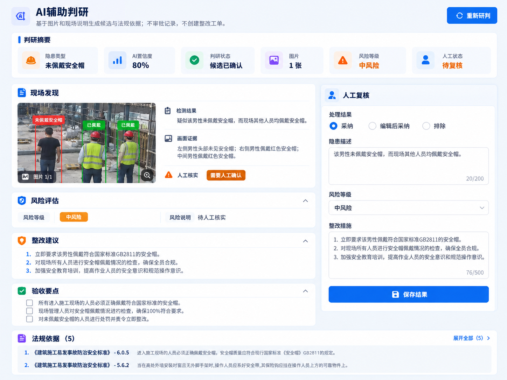
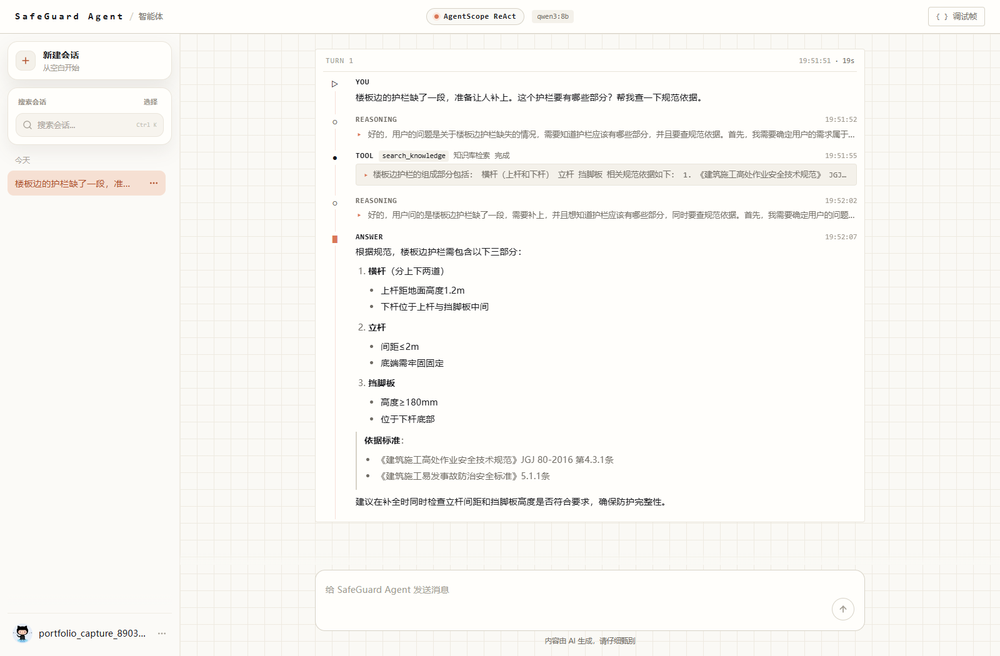
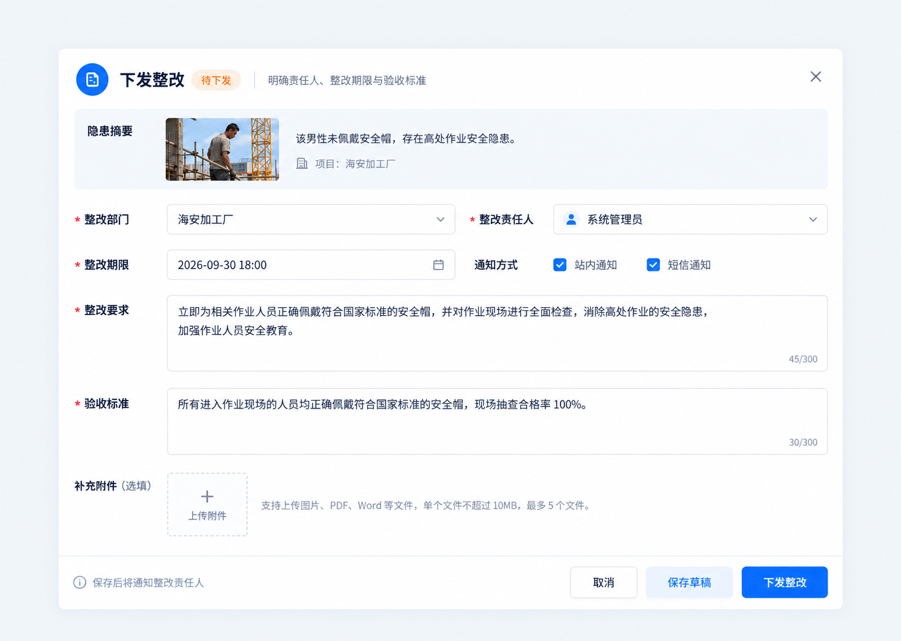
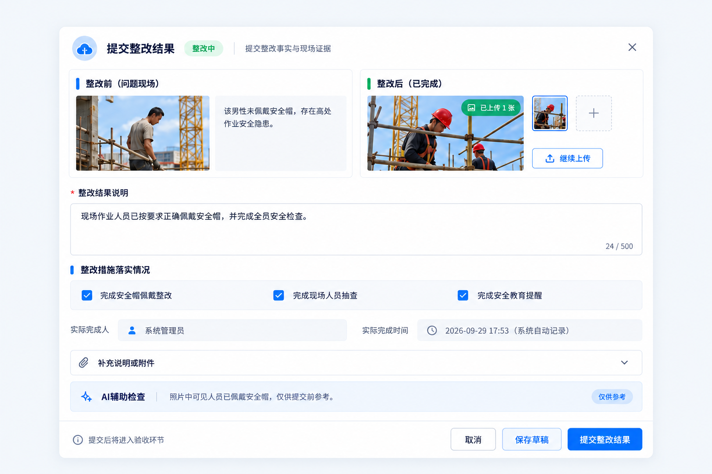
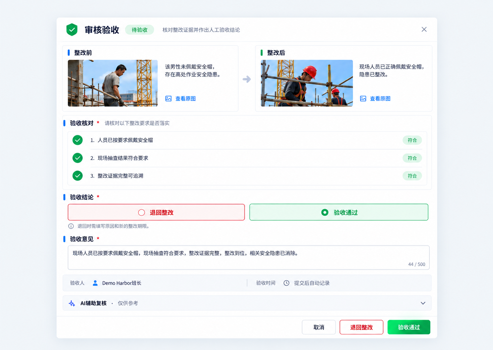
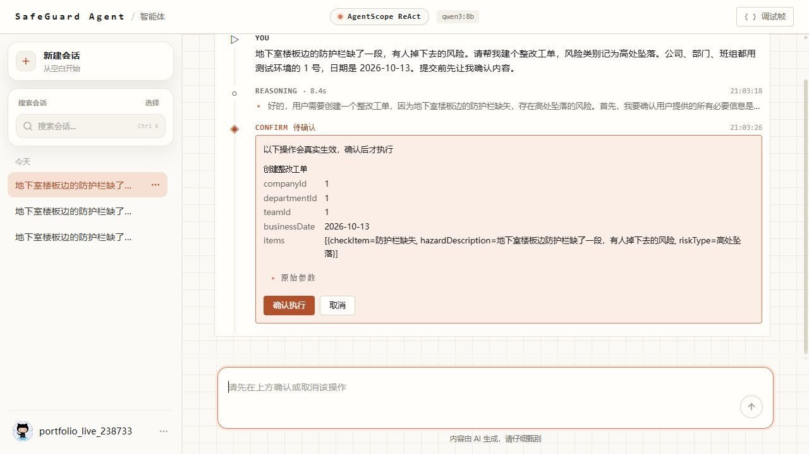
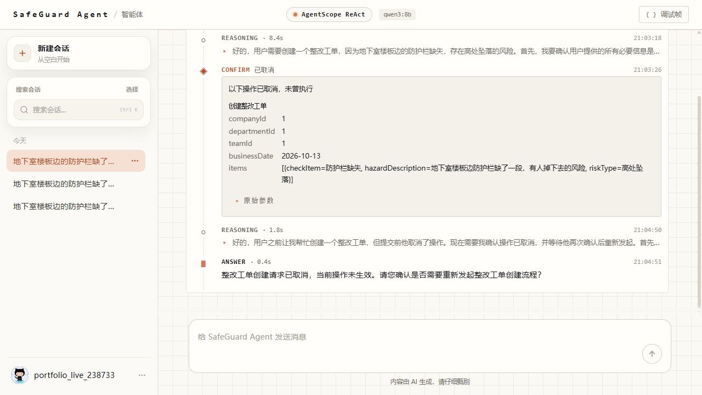
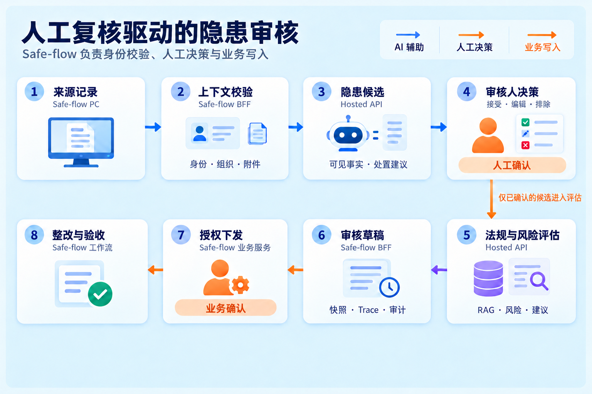
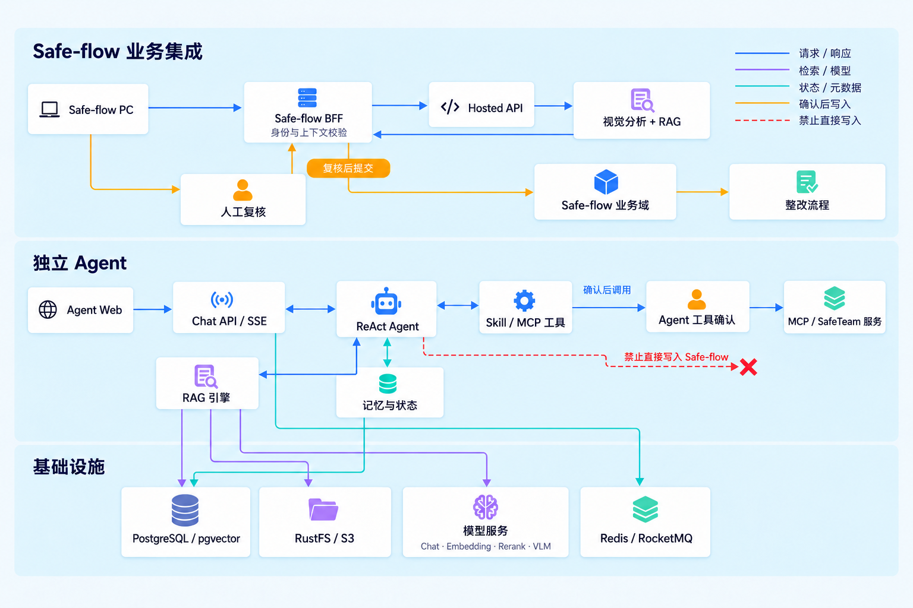

# SafeGuard Agent

**施工安全隐患整改 AI Agent**

让 AI 辅助隐患分析，让人工完成安全决策，让业务系统完成整改闭环。

## 项目角色

**Project Owner｜独立完成 AI 产品设计与系统开发。** 我从施工安全业务问题出发，定义产品边界与用户流程，再将 AI 方案实现为可运行、可检查、可接入业务系统的应用。

- **业务与产品：** 分析施工安全隐患整改场景，明确目标用户、核心流程和人工决策点。
- **Agent 方案：** 设计 ReAct 工作流、工具调用与 Human-in-the-loop 确认机制。
- **知识增强：** 构建法规知识库，设计混合检索、重排、证据筛选与引用追溯。
- **工程落地：** 开发 Agent 服务与前端交互，完成与 Safe-flow 的业务集成。
- **验证迭代：** 设计法规检索评测与测试体系，用真实模型运行检查交互和执行边界。

> **3 分钟了解项目：** [为什么做](#1-项目背景) → [用户与流程](#2-产品定位) → [核心能力](#3-核心能力) → [关键设计](#4-产品关键设计) → [验证结果](#6-效果验证)

| 产品作用 | 产品边界 |
| --- | --- |
| 为施工现场隐患审核提供候选、法规依据和整改建议 | 安全员核实并决定是否采用；[Safe-flow](https://github.com/oujiajing/safe-flow)负责权限、工单与整改流转 |

**展示口径：** Safe-flow 页面是演示场景数据；独立 Agent 对话与待确认截图来自本机真实模型运行。当前没有生产环境效果数据，也没有通过自然语言入口成功创建真实整改工单。

## 1. 项目背景

施工安全隐患从“发现”到“整改完成”横跨现场判断、法规核查、任务整理和业务流转。项目要解决的不是单次问答，而是这些步骤之间的信息断层：

| 现场工作中的问题 | 对应的产品设计 |
| --- | --- |
| 隐患发现与风险判断依赖安全员经验 | 从现场描述或图片生成**待核实的隐患候选**，保留人工修改与排除 |
| 查找适用规范、核对条款耗时 | 检索法规知识库，展示建议所依据的内容供复核 |
| 整改要求、责任与证据需要反复整理 | 将分析结果组织成可审查的建议或草稿 |
| AI 的回答无法直接成为可信业务记录 | 将判断权交给人，将权限、状态和审计交给 Safe-flow |

这里的“辅助”有明确边界：模型可能误判现场情况或引用不适用的规范，因此候选与引用都需要结合现场条件和规范版本核验。

## 2. 产品定位

**目标用户**

| 用户 | 需要完成的事 | 在产品流程中获得的支持 |
| --- | --- | --- |
| 安全员 / 隐患审核人 | 判断隐患是否成立、依据是否适用 | 隐患候选、风险建议、法规依据与整改建议 |
| 班组长 / 整改责任人 | 理解整改要求、提交措施和证据 | 通过 Safe-flow 查看经审核的整改要求与验收要点 |
| 项目负责人 / 验收人员 | 跟踪整改责任与结果 | 在 Safe-flow 中查看流程、证据和审核结论 |

**核心场景：** 现场描述或图片 → AI 提出隐患候选 → 法规检索与整改建议 → 人工接受、修改或排除 → Safe-flow 按业务权限完成下发、提交与验收。

这是一条**人机协同的产品流程**，不是“AI 自动创建并关闭工单”。目前 Safe-flow 随手拍审核页面已接入候选复核、法规评估、草稿与审计；真实整改工单写回默认关闭。独立 Agent 的写工具待确认与取消路径已在本机运行验证，但自然语言入口的直接写入仍受执行器拦截。

## 3. 核心能力

### AI 隐患分析：把现场输入变成可复核候选

Safe-flow 集成场景接收现场图片和上下文，展示可见事实、隐患候选、风险建议与整改要点；独立 Agent 支持文本对话。审核人可以接受、编辑或排除候选，避免把“模型识别到”直接当作“业务已认定”。



### 法规知识增强：建议需要有出处

法规 RAG 对知识库进行检索、融合、重排与证据筛选，再把相关条款交给 Agent 形成建议。界面可查看工具调用与结果摘要；引用提供核对入口，不代表条款一定适用于当前工程。

2026 年 10 月 11 日的一次本机运行中，用户询问缺失护栏应有哪些组成部分及规范依据。AgentScope ReAct 调用 `search_knowledge` 后，给出横杆、立杆、挡脚板等建议。该截图是实际模型对话，没有上传现场图片或执行业务写入。



### Agent 任务执行：让过程可观察

AgentScope ReAct 负责规划和调用工具。独立 Web 界面按轮次展示 reasoning、工具调用、确认事件与最终回答；SSE 让使用者看到过程，服务端保留会话与待确认状态。涉及副作用的工具会进入人工确认流程。

### 人机协同：三方各守自己的职责

| AI Agent | 人 | Safe-flow 业务系统 |
| --- | --- | --- |
| 分析现场信息、检索依据、提出建议和待确认动作 | 核实事实与法规，接受、修改、取消或作出最终判断 | 校验身份与权限，管理责任、状态、审计和整改闭环 |

<details>
<summary><strong>查看 Safe-flow 下发、提交与验收页面（演示场景数据）</strong></summary>

**下发整改：** 业务人员确定责任人、期限与验收标准。



**提交结果：** 整改人填写落实情况并提交前后证据。



**审核验收：** 验收人员核对证据，决定通过或退回。



</details>

## 4. 产品关键设计

### 设计一：为什么 AI 不能直接创建整改任务？

施工安全决策会影响人员责任、整改期限和现场处置。模型输出可能遗漏现场条件，工具参数也可能与用户意图不一致。因此设计上把“建议”与“执行”分开：**AI 生成候选 → 人核对和确认 → 业务系统按权限执行**。

独立 Agent 的一次真实运行说明了这个边界。2026 年 10 月 13 日，`qwen3:8b` 根据“地下室楼板边防护栏缺了一段”的请求调用 `create_rectification_order`，界面展示工具参数并等待确认。随后用户点击“取消”，调用显示“已取消，未曾执行”。



<details>
<summary><strong>查看取消后的实际运行结果</strong></summary>



</details>

**验证范围：** 这组截图证明真实模型调用、参数展示和取消路径，不证明工单写入。当前 SafeTeam 写工具执行器还会拦截自然语言入口的直接写入，即使点击“确认执行”，也不能据此宣称已创建业务工单。

### 设计二：Agent 与业务系统解耦

Agent 提供智能分析，Safe-flow 掌握身份、组织数据范围、流程状态与权威记录。Safe-flow BFF 重建业务上下文，审核人复核候选后才形成评估草稿；整改下发、提交和验收沿用业务侧流程。这样做使模型建议可以被利用，也能被追溯和纠正。



## 为什么采用 Agent 架构？

传统知识库问答通常止于“用户提问 → 检索 → 回答”。施工安全隐患整改还需要根据现场信息决定下一步：查找法规依据、组织整改建议、调用相应工具，并在可能影响业务数据时等待人工确认。

**现场信息 → 隐患分析 → 法规检索 → 整改建议 → 工具调用 → 人工确认 → 业务系统处理**

因此我用 Agent 组织检索、建议与工具调用，把多个能力连接成可观察、可中断的工作流。采用 Agent 的目的在于承接多步骤业务任务；它不替代安全员判断，也不绕过 Safe-flow 的权限与流程。

## 我的实现

### AI 能力

构建施工安全法规知识库，使用混合检索与 Rerank 获取相关条款，并通过证据门控和引用信息支持人工核对。

### Agent 系统

基于 AgentScope ReAct 组织 Tool Calling；通过 SSE 展示运行事件与工具结果，以 Human-in-the-loop 机制处理需要确认的动作。

### 应用开发

开发独立 Agent 前端交互界面与服务端，并将隐患候选、法规评估和人工复核能力接入 Safe-flow 审核场景。具体接入范围与写入限制见下方[效果验证](#6-效果验证)。

## 5. AI 技术架构



| 能力层 | 作用 |
| --- | --- |
| AgentScope ReAct | 组织推理、工具选择与多轮执行 |
| 法规 RAG | 文档摄取、多路召回、融合、重排、证据门控与引用 |
| Tool Calling / MCP Tool Bridge | 把知识检索和业务能力以工具形式提供给 Agent |
| SSE 事件流 | 向界面逐步呈现 reasoning、tool、confirm 与 answer |
| Confirm Gate 与状态管理 | 保存待确认调用；服务端重新读取参数并处理同意或拒绝 |
| Safe-flow 集成 | 由 BFF 提供可信业务上下文，业务系统负责权限、审计和最终流程 |

<details>
<summary><strong>展开工程实现、代码与测试入口</strong></summary>

| 关注点 | 代码与验证 |
| --- | --- |
| ReAct 与事件流 | [ReAct 配置](agent/src/main/java/com/safeguard/agent/agent/config/ReActAgentProvider.java) · [事件桥接](agent/src/main/java/com/safeguard/agent/agent/service/handler/AgentStreamEventBridge.java) · [事件测试](agent/src/test/java/com/safeguard/agent/agent/service/handler/AgentStreamEventBridgeTest.java) |
| 检索与证据 | [检索编排](rag/src/main/java/com/safeguard/agent/rag/core/retrieval/MultiChannelRetrievalEngine.java) · [证据门控](rag/src/main/java/com/safeguard/agent/rag/core/retrieval/postprocessor/EvidenceGatePostProcessor.java) · [门控测试](rag/src/test/java/com/safeguard/agent/rag/core/retrieval/postprocessor/EvidenceGatePostProcessorTest.java) |
| 人工确认与写入边界 | [确认处理](agent/src/main/java/com/safeguard/agent/agent/service/impl/AgentChatServiceImpl.java) · [状态测试](agent/src/test/java/com/safeguard/agent/agent/service/impl/AgentConversationServiceImplTest.java) · [SafeTeam 写工具执行器](agent/src/main/java/com/safeguard/agent/agent/integration/safeteam/SafeTeamToolExecutor.java) |
| 仓库结构 | [frontend](frontend/) · [agent](agent/) · [rag](rag/) · [infra-ai](infra-ai/) · [bootstrap](bootstrap/) · [resources](resources/) |

</details>

## 6. 效果验证

验证分为**法规检索评测、Agent 实际运行、业务集成与工程测试**。截图用于说明交互和执行路径，不能替代质量评测或生产环境数据。

| 验证对象 | 已有证据 | 如何理解 |
| --- | --- | --- |
| 法规知识库 | 本地法规文档摄取与知识单元索引 | 验证知识入库和检索链路，不代表生产覆盖范围 |
| 检索评测 | 覆盖单条款、数值、复合和不可回答问题的本地评测报告 | 题目由条款生成并由单人核对，不是独立盲测集 |
| Agent 运行 | ReAct 调用 `search_knowledge` 的本机截图 | 证明工具调用与结果可观察；不证明答案始终正确 |
| 人工确认 | `create_rectification_order` 待确认与取消截图 | 证明取消未执行；没有成功业务写入的证据 |
| 业务集成 | Safe-flow 审核页面的候选复核、评估草稿与审计 | 页面截图使用演示场景数据 |
| 工程验证 | 后端测试、前端构建、CI 与本地运行检查 | 检查工程可运行性，不等同于产品效果 |

**检索评测方法：** [本地评测报告](outputs/legal-evaluation-v0.1/canonical-v2-fallback-hybrid-2026-09-20-metrics-live.json)分别检查候选召回、重排排序、最终证据保留、复合问题的多条款覆盖和不可回答问题的误引。评测暴露出证据筛选与复合条款覆盖仍需改进；候选召回表现不能代替最终答案质量。

```powershell
./mvnw.cmd test
./mvnw.cmd -DskipTests package
npm --prefix frontend run lint
npm --prefix frontend run build
./scripts/test-dev-runtime.ps1
```

[CI 工作流](.github/workflows/ci.yml)包含后端编译、前端生产构建、Secret Scan 和 Demo Adapter 核心测试。

</details>

## 7. 项目总结

这是一次我独立完成的 **从 0 到 1 的 AI 产品 Builder 实践**：从施工安全业务问题分析出发，完成产品方案与人机分工设计，选择 Agent + RAG 技术路径，开发前后端并接入 Safe-flow，再用检索评测、测试和真实模型运行验证关键路径。

这个过程集中体现了我的四项能力：

- **B 端业务理解：** 区分隐患判研、法规核查、整改执行和验收中的不同责任。
- **AI 产品设计：** 定义 AI 的建议角色、人工确认点和业务系统的执行边界。
- **Agent 应用开发：** 实现 ReAct、RAG、工具调用、SSE 事件流及确认状态管理。
- **企业系统落地：** 将智能能力接入现有业务审核流程，同时保留权限、审计和状态机。

目前验证的是本地模型运行、人工确认的取消路径和演示场景下的业务集成；生产效果与真实工单写回仍需进一步验证。

**下一步：** 补充独立图片与法规评测样本、完善引用和答案质量指标、提供可复现的 Fresh Clone 初始化与部署说明。

<details>
<summary><strong>本地开发运行与项目说明</strong></summary>

当前脚本面向已有基础数据和本地模型的 Windows 开发环境，尚未提供完整的 Fresh Clone 初始化流程。`scripts/start-tei.ps1` 的默认模型路径需按本机调整。需要 Windows 10/11、PowerShell 7、Docker Desktop、JDK 21、Node.js 20+、可用的 Chat Model Provider 和 Embedding Provider。

```powershell
npm --prefix frontend ci
$env:SAFEGUARD_POSTGRES_PASSWORD = "<local-postgres-password>"
$env:SAFEGUARD_REDIS_PASSWORD = "<local-redis-password>"
$env:SAFEGUARD_RUSTFS_ACCESS_KEY_ID = "<local-access-key>"
$env:SAFEGUARD_RUSTFS_SECRET_ACCESS_KEY = "<local-secret-key>"
$env:SILICONFLOW_API_KEY = "<your-api-key>"
$env:SAFEGUARD_DEMO_MODE = "true"

./scripts/start-dev.ps1 -StartRocketMq
./scripts/check-dev.ps1
```

启动后访问 `http://127.0.0.1:5173`；停止应用进程使用 `./scripts/stop-dev.ps1`。配置见 [application.yaml](bootstrap/src/main/resources/application.yaml)。演示模式下写操作不可作为真实业务写入验证。

**License：** 仓库目前未附带开源许可证，默认保留全部权利。

</details>
