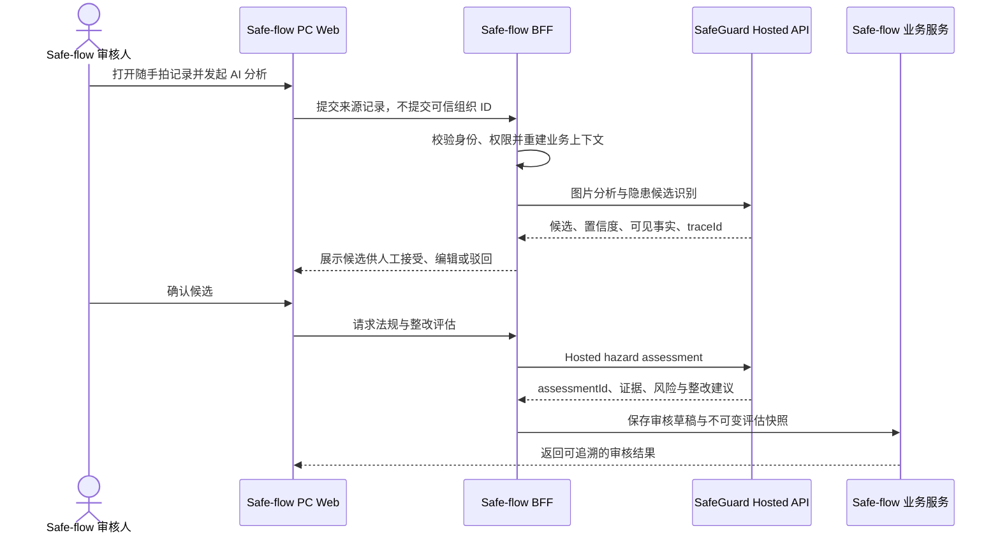
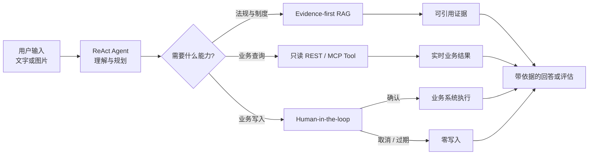
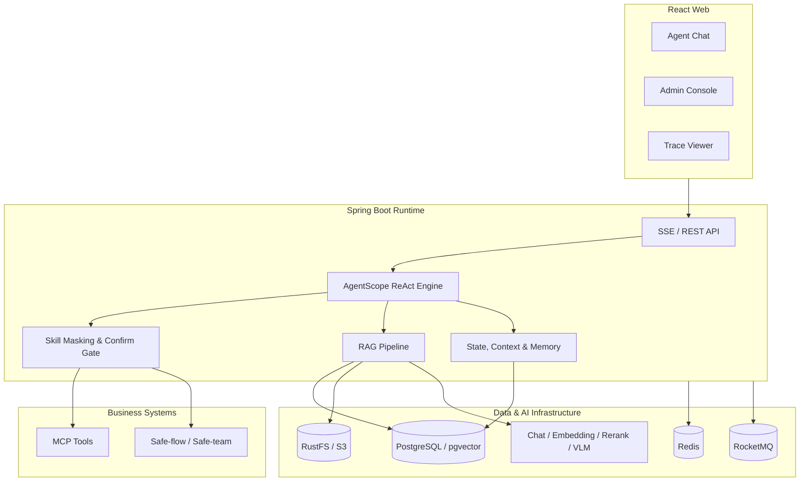

<div align="center">
  
  <h1>SafeGuard Agent</h1>
  <p><strong>面向建筑施工安全的证据驱动 Agent</strong></p>
  <p>从隐患理解、法规检索到人工确认与整改闭环，让每一次判断都可追溯，让每一次写入都可控制。</p>
  <p>
    <a href="https://github.com/oujiajing/safeguard-agent/actions/workflows/ci.yml"></a>
    <a href="https://openjdk.org/"></a>
    <a href="https://spring.io/projects/spring-boot"></a>
    <a href="https://react.dev/"></a>
    <a href="https://github.com/agentscope-ai/agentscope-java"></a>
  </p>
  <p>
    <a href="#核心能力">核心能力</a> · <a href="#工作方式">工作方式</a> · <a href="#快速开始">快速开始</a> · <a href="#系统架构">系统架构</a> · <a href="#安全边界">安全边界</a>
  </p>
</div>

---

SafeGuard Agent 不是只会生成答案的安全知识助手。它已经接入 **Safe-flow 真实业务平台**，能够在施工安全业务页面中把文字或图片隐患转换为结构化事实，检索可引用的法规依据，生成整改建议，并在任何可能产生业务副作用的动作前交还人工确认权。

项目同时提供完整的 Web 交互界面、可观察的 ReAct 执行轨迹、知识库与 Agent 管理后台，以及与业务主系统 Safe-flow / Safe-team 的受控集成边界。

## 产品预览

> [!NOTE]
> 📷 **真实产品截图待补充 ①：Agent 对话主界面**<br>
> 建议同时展示用户问题、reasoning、知识库工具调用和最终回答，让读者第一眼看到区别于普通聊天机器人的完整执行轨迹。推荐使用脱敏后的真实会话，宽度不低于 1440 px，文件保存为 `docs/images/agent-chat-overview.png`。补图后将本提示替换为：<br>
> ``

## 已接入真实业务平台：Safe-flow

SafeGuard Agent 已接入 Safe-flow PC Web 的真实业务流程，首个落点位于 **隐患排查 → 随手拍 → 已上报记录的明细/审核页面**（路由 `/pingan/hazard-inspection/quick-shot`）。接入采用 Safe-flow 原生侧栏与审核卡片，不使用 iframe，也不要求业务用户再次登录独立 Agent。

当前真实链路已经覆盖：

1. 审核人在 Safe-flow 随手拍记录中发起图片分析。
2. Safe-flow 服务端根据当前登录人重建组织、来源记录和附件上下文，并通过 BFF 调用 Agent Hosted API。
3. Agent 返回视觉隐患候选；审核人可以逐条接受、编辑或驳回，未经确认的候选不会进入下一阶段。
4. Safe-flow 使用确认后的候选请求法规评估，保存风险等级、整改建议、验收标准、法规证据和 Trace。
5. 审核草稿、图片快照、候选决定、`runId`、`assessmentId` 及审计信息均由 Safe-flow 持久化。
6. 后续整改工单仍由 Safe-flow 的权限、状态机、幂等与事务链路负责，Agent Hosted API 不提供绕过业务系统的工单写接口。



| Safe-flow 接入能力 | 当前状态 |
|---|---|
| PC 随手拍真实业务页面 Agent 入口 | 已接入 |
| 图片分析与视觉候选展示 | 已接入 |
| 候选接受、编辑与驳回 | 已接入 |
| 法规评估与整改建议 | 已接入 |
| Run、图片快照、决定、评估与审计持久化 | 已接入 |
| Agent 辅助结果生成整改草稿 | 方案与边界已定义，继续完善 |
| 真实整改工单写入 | 默认关闭；必须由 Safe-flow 人工确认并走原业务事务 |

> [!NOTE]
> 📷 **真实产品截图待补充 ②：Safe-flow 随手拍审核页中的 Agent 面板**<br>
> 这是最能证明“已接入真实业务平台”的截图。建议同时包含 Safe-flow 页面标题或面包屑、原始隐患图片、Agent 候选、人工接受/驳回操作及法规评估结果；请先对项目名称、人员、组织和现场图片做脱敏。推荐文件名为 `docs/images/safe-flow-agent-review.png`。补图后将本提示替换为：<br>
> ``

接入架构遵循“Agent 负责分析与建议、Safe-flow 负责身份与业务写入”的边界；Hosted API 仅返回结构化分析结果，不绕过业务系统的权限、状态机和审计链路。

## 为什么是 SafeGuard

| 常见问题 | SafeGuard 的设计 |
|---|---|
| 回答看似专业，却说不清依据来自哪里 | 检索、重排、证据门控与行内引用组成 evidence-first RAG 链路 |
| Agent 调了什么工具、为什么这么做不可见 | 将 reasoning、tool、confirm、answer 以 SSE 事件流实时呈现 |
| 模型可能在用户不知情时执行写操作 | 高风险工具默认进入 Human-in-the-loop 确认门禁 |
| 长会话持续膨胀，早期信息逐渐丢失 | 上下文压缩、会话状态持久化与长期记忆分层处理 |
| 通用 Agent 不理解企业流程和权限边界 | Agent 负责分析与建议，业务主系统负责权限、状态和最终事实 |

## 核心能力

- **施工安全隐患理解**：支持文字隐患评估与图片候选识别，将可观察事实、风险和整改建议组织为结构化结果。
- **法规证据检索**：支持 Query Rewrite、向量召回、可选关键词召回、RRF、Rerank、Evidence Gate 与引用生成。
- **可观察 Agent 运行时**：基于 AgentScope 的 ReAct 循环，前端实时展示思考、工具调用、耗时、结果与原始 SSE 帧。
- **人工确认门禁**：对有副作用的工具展示名称、参数和影响范围；确认后执行，拒绝或过期则保持零写入。
- **渐进式技能加载**：Agent 先读取技能清单，在需要时加载操作手册并解锁对应 MCP 工具，减少无关上下文和误调用。
- **会话与长期记忆**：PostgreSQL 持久化 Agent 状态，支持上下文压缩、用户长期记忆提取和显式记忆整理。
- **知识运营后台**：覆盖知识库、文档摄取、切片、意图树、查询词映射、Agent 人设、提示词、技能和 Trace 管理。
- **真实业务系统集成**：已嵌入 Safe-flow PC 随手拍审核页，通过 BFF 与 Hosted API 完成候选识别、人工复核、法规评估、草稿保存和全链路审计；Demo Adapter 用于隔离验证。

## 工作方式



一次典型的隐患处理会经历：

1. 从描述或图片中提取可观察事实，不臆测尺寸、证件、荷载等不可见信息。
2. 将隐患事实改写为检索问题，从法规知识库召回、融合和筛选证据。
3. 生成带证据的风险判断、整改措施与验收建议。
4. 如用户明确要求创建整改任务，先展示确认卡；只有确认后才调用业务系统。
5. 保存完整 Trace，便于回放模型推理、工具调用、证据和执行结果。

> [!NOTE]
> 📷 **真实产品截图待补充 ③：Human-in-the-loop 确认卡**<br>
> 建议截取“待确认”状态，完整显示工具中文名、关键参数、确认执行与取消按钮；避免包含 Token、人员隐私或真实项目敏感数据。推荐文件名为 `docs/images/human-confirmation-gate.png`。补图后将本提示替换为：<br>
> ``

## 快速开始

> [!IMPORTANT]
> 当前启动脚本面向已经准备好基础数据和本地模型的 Windows 开发环境。仓库尚未提供完整的 Fresh Clone 初始化数据，`scripts/start-tei.ps1` 的默认模型路径也需要按本机修改。请先阅读下面的“当前项目状态”，不要将开发脚本直接用于生产环境。

### 环境要求

- Windows 10/11 + PowerShell 7
- Docker Desktop
- JDK 21
- Node.js 20+
- 一个 OpenAI-compatible Chat Model API Key
- 本地 `bge-m3` 模型，或自行调整 Embedding Provider

### 1. 获取代码与安装前端依赖

```powershell
git clone https://github.com/oujiajing/safeguard-agent.git
cd safeguard-agent
npm --prefix frontend ci
```

### 2. 设置本地环境变量

默认配置使用 PostgreSQL、Redis、RocketMQ、RustFS、TEI Embedding 和 SiliconFlow Chat Model：

```powershell
$env:SAFEGUARD_POSTGRES_PASSWORD = "<local-postgres-password>"
$env:SAFEGUARD_REDIS_PASSWORD = "<local-redis-password>"
$env:SAFEGUARD_RUSTFS_ACCESS_KEY_ID = "<local-access-key>"
$env:SAFEGUARD_RUSTFS_SECRET_ACCESS_KEY = "<local-secret-key>"
$env:SILICONFLOW_API_KEY = "<your-api-key>"
$env:SAFEGUARD_DEMO_MODE = "true"
```

完整 Provider、检索和存储配置见 [`application.yaml`](bootstrap/src/main/resources/application.yaml)。所有凭据都应通过环境变量注入，不要提交到 Git。

### 3. 启动与检查

确认 `scripts/start-tei.ps1` 中的模型路径可用，并已完成数据库初始化后执行：

```powershell
./scripts/start-dev.ps1 -StartRocketMq
./scripts/check-dev.ps1
```

启动成功后访问：

| 服务 | 地址 |
|---|---|
| Web UI | <http://127.0.0.1:5173> |
| Backend | <http://127.0.0.1:9090/api/safeguard-agent/> |
| RustFS Console | <http://127.0.0.1:9001> |

停止应用进程：

```powershell
./scripts/stop-dev.ps1
```

## 系统架构



### 模块说明

| 模块 | 职责 |
|---|---|
| `frontend` | React + Vite Web UI，包含 Agent 对话、确认卡、知识运营与 Trace 页面 |
| `agent` | ReAct 运行时、工具目录、SSE 事件桥、确认门禁、技能加载、状态与记忆 |
| `rag` | 文档摄取、意图解析、混合检索、重排、证据门控、引用和质量评测 |
| `infra-ai` | Chat、Embedding、Rerank、VLM 等模型供应商适配 |
| `system` | 用户、认证、审计日志与系统级能力 |
| `framework` | Web、异常、校验、消息与通用基础设施封装 |
| `bootstrap` | Spring Boot 启动入口与运行配置 |
| `resources` | PostgreSQL Schema、升级脚本和 Docker Compose |

## 安全边界

SafeGuard 采用“分析系统”和“事实系统”分离的原则：

- Agent 可以理解问题、检索证据、生成建议和准备结构化参数。
- Safe-flow / Safe-team 负责用户权限、组织数据范围、流程状态、审计和最终业务写入。
- Agent 不直连业务主系统数据库，也不把模型输出直接视为业务事实。
- 写工具默认需要确认；独立 Demo 模式下可以保持真实业务写入关闭。
- Secret Scan 已纳入 CI，API Key、密码和 Token 必须通过环境变量提供。

独立 Agent、Hosted API 与 Safe-flow 的写入权限彼此隔离：当前真实平台接入已经覆盖分析、人工复核、法规评估和审核草稿，整改工单写入仍保持显式确认和业务侧权威执行。

## 质量与可观测性

项目将“代码正确”“检索质量”“真实环境集成”分层验证，而不是用单一 Demo 代替质量结论：

- CI 验证后端编译、前端生产构建、Secret Scan 和 Demo Adapter 核心测试。
- Agent Trace 记录 reasoning、tool、confirm、answer 等事件及执行耗时。
- 法规检索评测区分向量、BM25 与 Hybrid 通道，并单独统计复合题、不可回答题和错误引用。
- 图片评测区分生成样本与经过许可审计的真实样本，禁止用未完成来源审计的数据进入自动回归。

评测按静态契约、确定性组件、真实依赖集成和人工评审分层执行；指标仍在持续改进，仓库不会把检索命中等同于生成答案正确。

> [!NOTE]
> 📷 **真实产品截图待补充 ④：管理后台或 Trace 详情**<br>
> 优先选择最能证明工程完成度的页面：RAG Trace 详情、知识库文档管理或 Agent Skills 管理三选一。画面应包含筛选、状态、耗时或节点明细，推荐文件名为 `docs/images/observability-console.png`。补图后将本提示替换为：<br>
> ``

## 当前项目状态

SafeGuard Agent 目前处于 **可演示、持续工程化** 阶段：Agent 主链路、RAG、确认门禁、管理后台和业务集成边界已经落地；Fresh Clone 数据初始化、跨平台启动脚本、完整生成质量评分与生产部署手册仍在完善。

| 能力 | 状态 |
|---|---|
| ReAct Agent + SSE Trace | 已实现 |
| 法规 RAG + Citation | 已实现，持续评测优化 |
| Human-in-the-loop 写入门禁 | 已实现 |
| Skills + MCP Tool Bridge | 已实现 |
| 长期记忆与上下文压缩 | 已实现 |
| Safe-flow 真实业务平台接入 | PC 随手拍页面、候选复核、法规评估、草稿与审计已接入；真实工单写回默认关闭 |
| Fresh Clone 一键启动 | 完善中 |
| 生产级部署与监控手册 | 规划中 |

## 开发与验证

```powershell
# 后端测试
./mvnw.cmd test

# 后端构建
./mvnw.cmd -DskipTests package

# 前端检查与构建
npm --prefix frontend run lint
npm --prefix frontend run build

# 本地运行时脚本回归
./scripts/test-dev-runtime.ps1
```

如需调整数据库结构，新环境使用 `resources/database/schema_pg.sql`，已有环境按文件名顺序应用 `resources/database/upgrades/` 下的增量脚本。不要修改已经对外执行过的升级脚本。

## Roadmap

- [ ] 提供可复现的 Fresh Clone 初始化数据与跨平台一键启动
- [ ] 增加真实施工场景的许可数据集与视觉质量基线
- [ ] 完善生成答案的 Faithfulness、Claim Coverage 与 Citation Precision 评测
- [ ] 增加依赖故障注入、性能分位数与生产级可观测性
- [ ] 补充部署、贡献、安全策略与版本发布文档

## License

仓库当前尚未附带开源许可证。除非仓库所有者另行授权，否则默认保留全部权利。若计划开放社区使用或接受外部贡献，建议在发布前补充明确的 License、`CONTRIBUTING.md` 与 `SECURITY.md`。

---

<div align="center">
  <sub>Built for evidence-grounded decisions and human-controlled actions.</sub>
</div>
